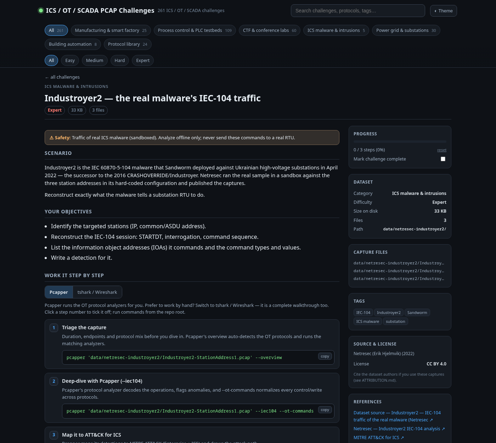

<div align="center">

# 🏭 ICS / OT / SCADA PCAP Challenges

**A free, guided network-forensics range for industrial control systems.**

327 hands-on challenges · 67 credited public datasets · 28 OT protocols · ~354 GB of real and testbed traffic

[**▶ Open the challenge range**](https://sackofhacks.github.io/ICS-PCAP-Challenges/) &nbsp;·&nbsp;
[Browse all challenges](challenges/README.md) &nbsp;·&nbsp;
[Quickstart](#-quickstart-5-minutes) &nbsp;·&nbsp;
[Credits](ATTRIBUTION.md)




</div>

---

## What is this?

Real industrial network traffic is hard to come by — and harder to *learn from*. This repo turns
**67 public ICS/OT/SCADA packet-capture datasets** into **327 guided challenges**:
substation protocols under attack, PLCs being hijacked, a safety-system malware, a real incinerator
plant, a robotics cell under security scans, building-automation attacks, CTF captures from ICS villages,
and a deep protocol library.

Every challenge gives you a **scenario**, **objectives**, **step-by-step commands**, **progressive hints**,
a **reveal-able solution** with **computed evidence** (facts extracted from the packets by script, so you
can check your work), and the **credit and license** of the data it's built on.

| Theme | Challenges | What you'll practise |
|---|---:|---|
| **Power grid & substations** | 77 | IEC-104, DNP3, IEC 61850 GOOSE/MMS/SV, synchrophasors — attacks on substations and grid operations |
| **Process control & PLC testbeds** | 130 | Modbus and S7 testbeds and labs — recon, floods, MITM, value injection, PLC hijacking |
| **ICS malware & intrusions** | 5 | TRITON/TriStation, Industroyer2, exploitation and C&C inside control networks |
| **Building automation** | 8 | KNXnet/IP and BACnet — bus scans, floods and unauthorised group-value writes in building systems |
| **CTF & conference labs** | 60 | ICS Village CTF and conference-lab captures — find the flag, reconstruct the competition |
| **Manufacturing & smart factory** | 23 | Factory-cell and robotics traffic — baselines, unlabeled attack days, security-control footprints |
| **Protocol library** | 24 | one deduplicated deep-dive per OT protocol — learn each protocol's grammar and its dangerous operations |

**Protocols covered:** ANSI C12.22 · BACnet · Beckhoff ADS/AMS · C37.118 synchrophasor · DLMS/COSEM · DNP3 · EtherCAT · EtherNet/IP & CIP · HART-IP · IEC 61850 GOOSE · IEC 61850 MMS · IEC 61850 R-GOOSE · IEC 61850 SV · IEC-104 · KNXnet/IP · LS XGT FEnet · LonTalk · Modbus/TCP · Niagara Fox · OPC DA (DCOM) · OPC UA · Omron FINS · POWERLINK · PROFINET · ROC Plus · S7comm · S7comm-plus (S7-1200/1500) · TriStation

**Scope: ICS / OT / SCADA only.** A script admits each challenge only if at least one of its captures
carries an industrial protocol decoded by `tshark` (generic layers such as TPKT/COTP, LLDP or plain DCOM
don't count). `scripts/fetch.py` then keeps only the files the challenges use, their ground truth and
the dataset's own documentation. IT-only and IoT traffic is out of scope.

## 🔧 Built around Pcapper

The challenges are designed to be worked with **[Pcapper](https://github.com/SackOfHacks/pcapper)** —
a modular PCAP forensics tool with dedicated ICS/OT analyzers (Modbus, DNP3, IEC-104, S7, EtherNet/IP &
CIP, IEC 61850 MMS/GOOSE/SV, BACnet, OPC UA, PROFINET, TriStation and more), OT command normalization,
control-loop analysis and MITRE ATT&CK for ICS mapping.

**Every challenge has two complete walkthroughs:** the **Pcapper** track (the default: its analyzers do the
heavy lifting) and the **tshark / Wireshark** track (the by-hand route: display filters, field extraction,
statistics). Switch between them with the toggle on each challenge page; the Markdown pages show both.

```bash
pcapper <capture> --overview            # auto-detects the OT protocols and runs the right analyzers
pcapper <capture> --modbus --ot-commands # protocol deep-dive + every control/write, normalized
pcapper <capture> --mitre                # map what happened to ATT&CK (Enterprise + ICS)
```

## 🚀 Quickstart (5 minutes)

**Requirements:** Python ≥ 3.9, `curl`, `7z` (p7zip), `tar`, and `tcpdump` (used to split captures ≥ 2 GB).
For the tshark / Wireshark walkthroughs, install Wireshark (which provides `tshark` and `capinfos`).

```bash
# 1. Install Pcapper (gives you the `pcapper` command)
git clone https://github.com/SackOfHacks/pcapper
cd pcapper && pip install . && cd ..

# 2. Get the challenge range
git clone https://github.com/SackOfHacks/ICS-PCAP-Challenges
cd ICS-PCAP-Challenges

# 3. Download a small starter set (< 1 GB) from the original sources, then index it
python3 scripts/fetch.py --starter
python3 scripts/build.py

# 4. Open the range in your browser and pick a challenge
xdg-open index.html        # macOS: open index.html   ·   Windows: start index.html
```

That's it — no server, no accounts, no build step to view it. Want everything? `python3 scripts/fetch.py --list`
shows every dataset and its size; fetch by name or with `--all` (~354 GB).

## 🖥️ Using the challenge range

### Locally — `index.html`

`index.html` is a static page that reads `challenges.js`. Double-click it (or `xdg-open index.html`).

- **Landing page** — every challenge as a card. Filter by **theme** and **difficulty**, or search by
  protocol, malware, technique or tag (try `GOOSE`, `TRITON`, `replay`, `T0855`).
- **Challenge page** — scenario → objectives → **numbered steps**: pick **Pcapper** or **tshark / Wireshark**
  with the toggle (your choice is remembered; each command has a copy button) → hints you open one at a
  time → **Reveal walkthrough / answer**. The sidebar shows the dataset, its
  capture files, and its **source & license**.
- **Progress** — click a step number to tick it off (tracked separately for each walkthrough), or mark the
  whole challenge complete. Progress is saved in your browser (localStorage) only.
- **Commands** are written to run **from the repo root**, against files in `data/`.

### Online — GitHub Pages

The same range is published at **https://sackofhacks.github.io/ICS-PCAP-Challenges/**. Use it to browse,
read and plan; the captures themselves are not hosted on GitHub, so run the commands against your local
clone after `scripts/fetch.py`.

Every challenge is also a **Markdown page** in [`challenges/`](challenges/README.md) — readable right
here on GitHub, with hints and solutions in collapsible sections.

## 🗂️ Getting the data

The captures are not in the git history (they total ~354 GB and belong to their authors). `scripts/fetch.py`
gets each dataset from the right place:

- **This repository's [`data-v1` release](https://github.com/SackOfHacks/ICS-PCAP-Challenges/releases/tag/data-v1)**
  mirrors the **38 datasets whose licence (or authors) allow redistribution** (~337 GB of captures),
  unmodified, as gzip-compressed parts under 2 GiB. Every part is SHA-256-checked against `catalog/datasets.json`
  before it is unpacked, and each dataset carries a `LICENSE-NOTICE.md` with its licence and required citation. 28 of them are still being uploaded; until their parts are all there, `fetch.py` takes them from the original source.
- **The original sources** (Zenodo, Mendeley Data, NIST, TU Wien, Netresec, GitHub, Kaggle, MEGA, …) for the other
  **29 datasets**, which their authors published without a licence that allows re-hosting. The fetcher
  unpacks them, keeps only the files the challenges use and writes a `PROVENANCE.md` credit file.

```bash
python3 scripts/fetch.py --list                         # every dataset: size, licence, mirror or source
python3 scripts/fetch.py netresec-industroyer2 cyber4ot # specific datasets
python3 scripts/fetch.py --all                          # everything
python3 scripts/fetch.py cyber4ot --from-source         # skip the mirror, use the original source
python3 scripts/build.py                                # re-index after fetching
```

Downloads resume if interrupted — just run the same command again.

## 🛡️ Safety

These are **real attack captures** — including traffic of actual ICS malware (Industroyer2, TRITON) and
exploit/C2 payloads. Work offline:

- **Never replay** this traffic onto a routed, production or industrial network.
- **Never send** the commands you find to a real PLC, RTU, IED or safety controller.
- Treat any file you carve as **live malware** — hash it, don't run it.

## 🙏 Credits

This range exists because researchers, vendors and the community published their data. **Please cite
the original authors** when you use the captures — full citations, licenses and DOIs for all
67 datasets are in **[ATTRIBUTION.md](ATTRIBUTION.md)**, and each challenge page shows its source.

Special thanks to TU Wien, NIST, the University of Western Macedonia, the University of Coimbra, Queensland University of Technology, Fraunhofer FKIE and RWTH Aachen University, TU Delft, KIOS CoE (University of Cyprus), Jordan University of Science and Technology, the Canadian Institute for Cybersecurity, Warsaw University of Technology, Université Grenoble Alpes, Mälardalen University, Polytechnique Montréal, ADSC Singapore, the CIARRES project, Netresec, CS3STHLM (4SICS), Digital Bond / S4, Nozomi Networks, CISA & Idaho National Laboratory, the University of Illinois ITI, OISF, the CybICS project, the ICS CTF organisers and archivists, and the community collectors credited in ATTRIBUTION.md.

## 🧰 Repo layout

```
ICS-PCAP-Challenges/
├── index.html               # the challenge range (static; open locally or via GitHub Pages)
├── challenges.js            # generated catalog the page reads
├── challenges/              # one Markdown page per challenge + README index
├── catalog/
│   ├── challenges.json      # challenge definitions (source of truth)
│   └── datasets.json        # credits, licences, mirror checksums and original download sources
├── scripts/
│   ├── fetch.py             # download datasets into data/ (release mirror or original source)
│   ├── mega_fetch.py        # public-MEGA-folder client used for one source-hosted dataset
│   └── build.py             # rebuild challenges.js, challenges/*.md and ATTRIBUTION.md
├── data/                    # the captures (git-ignored; created by fetch.py)
├── ATTRIBUTION.md           # credits and licenses for every dataset (generated)
├── CITATION.cff             # how to cite this range and its datasets
└── LICENSE                  # MIT — code and challenge authoring only
```

## 📄 License

The **code and challenge authoring** are [MIT](LICENSE). The **datasets are not covered by that license**: each
keeps its own licence. The ones mirrored in the `data-v1` release are redistributed under those licences
(several are **CC BY-NC / BY-NC-SA — non-commercial only**, others **CC BY-SA / GPL — share-alike**); the rest are
only downloaded from their sources. See [ATTRIBUTION.md](ATTRIBUTION.md).
